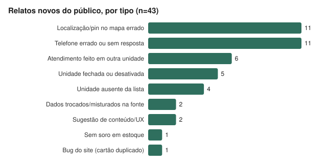
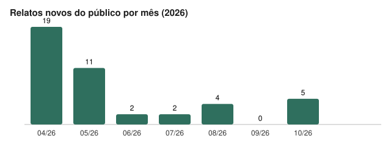
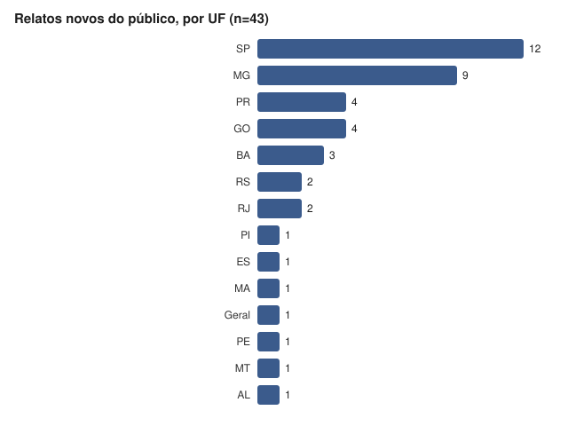
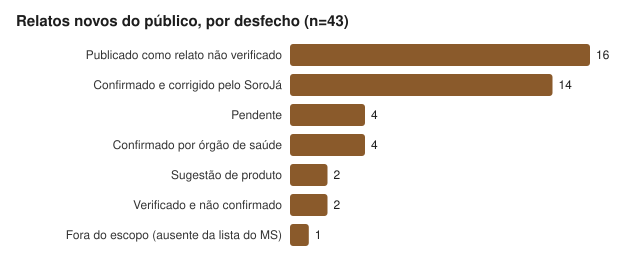
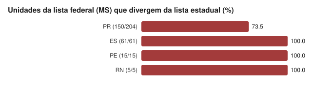

# Achado: correções do público e confiabilidade da lista oficial de soro antiveneno

_Consolidado em 13/11/2026. Fonte primária: planilha de controle "Error Reports Summary V2" (364 linhas, 22/04 a 22/10/2026), mais duas correções verificadas anteriores ao formulário (`data/location_overrides.json`). Denominador: 2.279 unidades publicadas no SoroJá (`app/hospitals.json`), derivadas da lista PESA do Ministério da Saúde de 03/07/2026._

> Este documento não traz nomes, e-mails ou o texto bruto dos relatos (LGPD-mínimo). A planilha de controle continua sendo a fonte privada.

## 1. Achado em uma frase

Em seis meses, sem nenhuma busca ativa, o público apontou erros em **35 das 2.279 unidades publicadas (1,5%)**. **18 de 20 relatos verificados se confirmaram (90%)**. Quando a lista federal foi comparada às listas das próprias secretarias estaduais, **231 de 285 unidades federais (81%) em PR, ES, PE e RN apareciam com outros dados ou não apareciam na lista estadual**.

## 2. O que o público relatou

**43 relatos novos** e **8 corroborações** (a mesma pessoa ou outra repetindo um relato já registrado), entre **20/04 e 22/10/2026**, de **13 UFs**. 40 dos 43 relatos tratam de erro de dado. Os outros 3 são sugestões de conteúdo ou um bug do site.

| Tipo de relato | Relatos |
| --- | ---: |
| Telefone errado ou sem resposta | 11 |
| Localização/pin no mapa errado | 11 |
| Atendimento feito em outra unidade | 6 |
| Unidade fechada ou desativada | 5 |
| Unidade ausente da lista | 4 |
| Dados trocados/misturados na fonte | 2 |
| Sem soro em estoque | 1 |
| Sugestão de conteúdo/UX | 2 |
| Bug do site (cartão duplicado) | 1 |

**Por UF:** SP 12, MG 9, PR 4, GO 4, BA 3, RS 2, RJ 2, e 1 cada em AL, ES, MA, MT, PE e PI (mais 1 sugestão geral).
**Por mês:** abr 19, mai 11, jun 2, jul 2, ago 4, set 0, out 5. O pico logo após o lançamento indica que o volume depende de divulgação, não de quantos erros existem.

## 3. Confirmados versus pendentes

| Desfecho (43 relatos novos) | Relatos |
| --- | ---: |
| Confirmado e corrigido pelo SoroJá (Google Maps, PDF oficial, ligação) | 14 |
| Confirmado por órgão de saúde (SES-RS, SESA-PR, secretaria/prefeitura municipal) | 4 |
| Publicado como "Relato da comunidade", ainda não verificado | 16 |
| Pendente de verificação | 4 |
| Verificado e não confirmado | 2 |
| Fora do escopo (unidade ausente da lista do MS) | 1 |
| Sugestão de produto | 2 |

- **Taxa de confirmação:** dos 20 relatos de dado que já foram checados, 18 se confirmaram (90%). Os 2 não confirmados são: uma alegação de fechamento (São Domingos/GO), que na verdade era um pin apontando para outro hospital em Goiânia, corrigido depois; e um hospital sugerido (Bento Gonçalves/RS) que não consta em nenhuma lista oficial.
- **Por unidade:** 35 unidades publicadas receberam relato de erro de dado.
  - 17 têm erro confirmado. Um registro adicional, o CNES 9491252, foi confirmado e ocultado porque a fonte misturava os dados de dois hospitais.
  - 16 têm só o relato publicado.
  - 2 estão pendentes.
- **Os 16 relatos não verificados** são, na maioria, telefones novos (9) e "o atendimento agora é em outra unidade" (4). Ficam visíveis com aviso de "informação não confirmada" até haver checagem.

## 4. O que isso mostra sobre o dado oficial

1. **Os erros vêm da fonte, não só do app.** Vários relatos expuseram falhas na própria lista do MS:
   - endereços da Santa Casa e da UPA de Passos/MG trocados entre si;
   - um registro de São José dos Campos/SP que reaproveita endereço e telefone de um hospital de São José do Rio Preto;
   - em Piranhas/AL, um CNES que pertence a uma UBS;
   - um único CNES (2115786) atribuído a unidades em 4 municípios de MG;
   - um telefone (Juiz de Fora) copiado entre unidades que dividem o mesmo CNES.
2. **A lista envelhece sem aviso.**
   - Unidades fechadas há anos continuam listadas: HPS Canoas/RS, fechado desde a enchente de 2024 e confirmado pela SES-RS; Hospital do Coração, em Cascavel/PR, demolido; Marmeleiro/PR.
   - Em outras cidades o atendimento mudou de lugar sem a lista mudar: Conselheiro Lafaiete/MG, confirmado pela prefeitura; Teixeira de Freitas/BA; Ponta Grossa/PR; Tatuí/SP.
   - Nos três casos do Paraná, a lista da própria SESA-PR já não inclui essas unidades. O relato do cidadão e a fonte estadual concordam entre si, contra a lista federal.
3. **As listas oficiais discordam entre si.** As comparações feitas a partir dos relatos e de pedidos às secretarias somam 310 linhas na planilha:

| UF | Fonte estadual | Unidades federais | Divergem ou ausentes no estado | % | Só na lista estadual |
| --- | --- | ---: | ---: | ---: | ---: |
| PR | SESA-PR, planilha de 01/07/2026 | 204 | 150 (55 ausentes + 95 com campo divergente) | 74% | 56 |
| ES | SESA-ES, painel Vacina e Confia | 61 | 61 | 100%* | 4 |
| PE | SES-PE, planilha de 08/2026 + Ouve.PE | 15 | 15 | 100% | 1 |
| RN | SESAP/RN, Ofício 2662/2026 | 5 | 5 | 100% | 2 |
| **Total** | | **285** | **231** | **81%** | **63** |

No PR, as 95 unidades com campo divergente somam 65 conflitos de soros, 24 de telefone, 14 de nome, 8 de endereço e 1 de município. Uma unidade pode divergir em mais de um campo.

\* A comparação do ES ainda não foi normalizada como a do PR. Parte das diferenças de endereço e nome pode ser só de formatação.

4. **Telefone é o ponto mais frágil para quem está numa emergência.**
   - O telefone é o tipo de relato mais comum, junto com a localização no mapa.
   - É também o campo que mais diverge entre as fontes oficiais de PE: 13 de 15 unidades.
   - Em PE, a resposta da SES-PE mostrou que vários números da planilha estadual eram de setores internos (vigilância, núcleo de epidemiologia), não de atendimento ao público.

## 5. Limites (dizer isso na proposta)

- **1,5% é um piso, não uma taxa de erro.** Os relatos são passivos e se concentram onde o app foi divulgado (SP e MG). A comparação com as listas estaduais mostra que a divergência real é muito maior.
- **Divergir não é o mesmo que estar errado.** As listas podem medir coisas diferentes. Por exemplo, a SESA-PR lista "locais de aplicação" e o MS lista "pontos estratégicos". Uma divergência só vira erro confirmado depois de resposta oficial ou checagem direta.
- **Nem todo erro de pin é do MS.** O SoroJá geocodifica os endereços do MS. Parte dos 11 relatos de localização vem de endereços ambíguos na fonte, e parte da própria geocodificação.
- **Nenhuma fonte informa estoque em tempo real.** A confirmação de uma unidade como referência não garante que haja soro disponível naquele dia.

## 6. Texto pronto para relatório ou proposta (PIPE)

> Entre abril e outubro de 2026, o SoroJá publicou as 2.279 unidades da lista oficial do Ministério da Saúde de pontos estratégicos de soro antiveneno e abriu um canal para correções do público. Sem nenhuma busca ativa, cidadãos e secretarias municipais enviaram 43 relatos de 13 estados. 40 apontavam erro de dado, sobretudo telefones desatualizados, pins de localização errados e unidades fechadas ou que não fazem mais o atendimento. Dos 20 relatos já verificados, 18 se confirmaram (90%), em 18 unidades distintas. Entre eles há unidades fechadas há anos, endereços trocados entre hospitais e códigos CNES atribuídos à unidade errada. Quando a lista federal foi comparada às listas das próprias secretarias estaduais em PR, ES, PE e RN, 81% das unidades federais (231 de 285) tinham dados diferentes ou não constavam da lista estadual. Em resumo, a fonte oficial de que depende uma pessoa picada por animal peçonhento não tem um processo de atualização que acompanhe a realidade. A verificação comunitária mostrou ter alto valor preditivo, mas hoje depende de esforço voluntário. O projeto propõe transformar esse achado num método sistemático e mensurável de validação contínua: relato do público, checagem ativa por telefone e conciliação com as secretarias.

## 7. Arquivos

- `relatos_publico.csv`: uma linha por relato do público, já classificada (sem nomes nem texto bruto).
- `comparacoes_oficiais.csv`: resumo por UF das comparações estado x federal.
- `resumo.json`: todos os números deste documento.
- `fig_*.svg`: gráficos.
- `build_finding.py`: script que regenera tudo. Rodar `python3 reports/public-corrections-2026-11/build_finding.py` a partir da raiz do repositório.

Fontes de apoio: `reports/pr_sesa_ms_reconciliation_2026-10-09.md`, `reports/pe_state_federal_reconciliation_2026-10-09.md`, `outreach/pesa_list_gaps.md`, `data/community_notes.json` e `data/location_overrides.json`.
